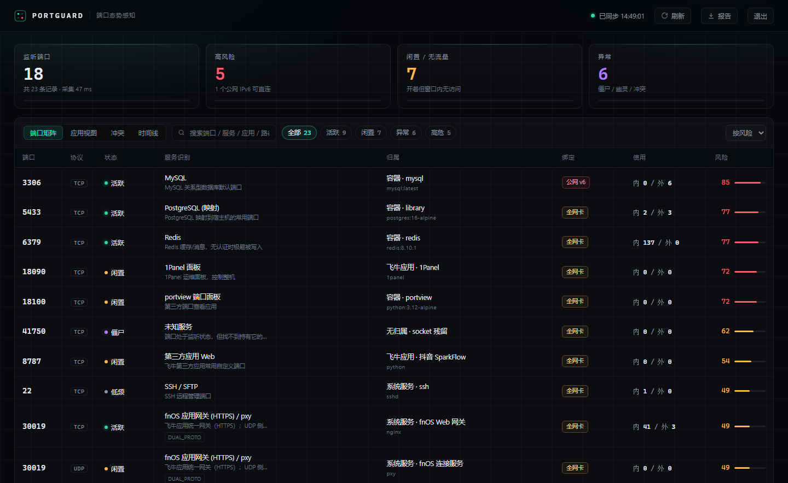
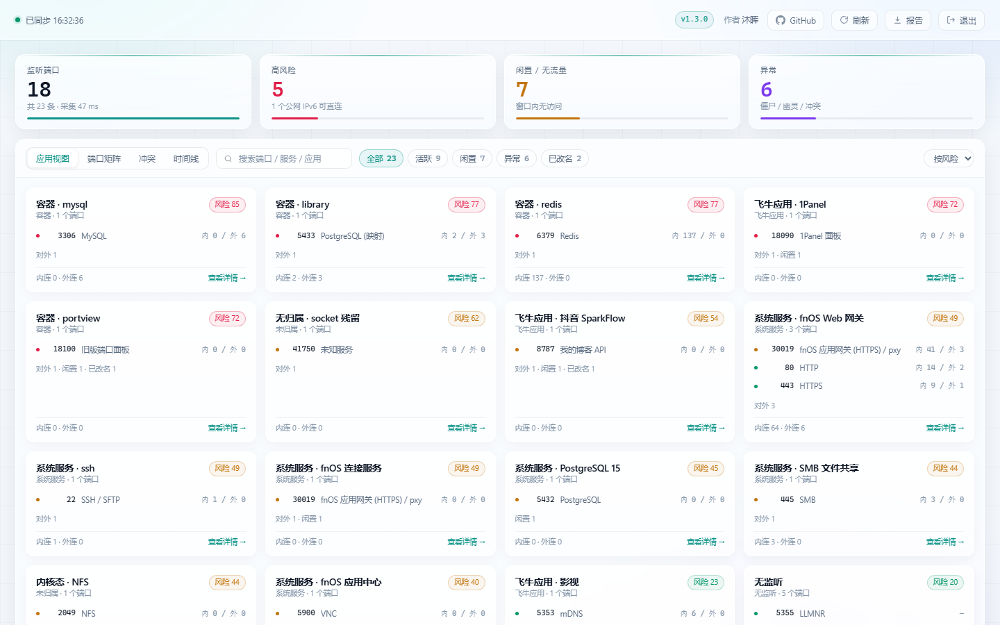
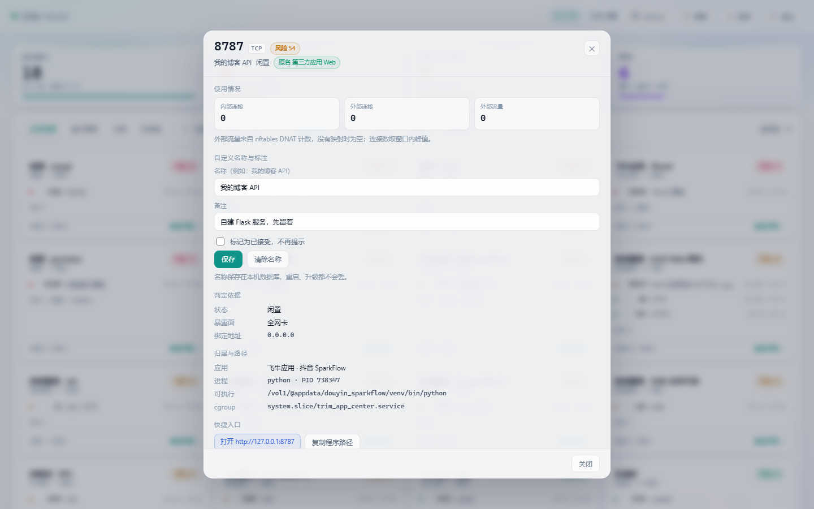

# PortGuard

飞牛 NAS 的端口态势感知应用，打包成 `.fpk`，从应用中心安装。

飞牛上关于端口的信息其实都在本机：`/proc/net/*` 里有 socket 表，`/proc/<pid>/cgroup` 能追到服务归属，`nft list ruleset` 里有容器映射和流量计数。`ss` 只是把第一层显示出来，后面几层要靠人自己拼。PortGuard 把这四层拼起来，给出判断；需要的时候，也能从界面上把端口背后的服务停掉。

## 它解决什么问题

`ss -tulnp` 会告诉你 `3306` 在监听、持有者是 `docker-proxy`。但它不会告诉你：

- 这个端口背后是哪个容器、哪个飞牛应用；
- 它到底有没有人用。开着不等于在用，而在用的端口也不等于对外在用；
- 它该不该开在这个地址上。绑 `127.0.0.1` 和绑 `[::]` 是两件事，后者在有公网 IPv6 的机器上可以直接被扫到。

举两个实测里的典型情况。

某台机器上 `6379` 有 137 条 ESTABLISHED，看上去很忙。但 nftables 的 DNAT 计数器是 0 包——这 137 条全是容器之间的调用，外部一次都没进来过。只看连接数会判断成"高频使用"，只看端口又会判断成"暴露面很大"，都不对。

另一个是 `41750`，TCP 和 UDP 都在监听，但 `/proc/*/fd` 里找不到任何持有者，`ss -e` 显示 `cgroup:unreachable`。这是容器退出后没回收的 socket，会一直占着端口，也不会出现在任何进程列表里。

这类情况靠肉眼扫 `ss` 很难发现，所以做了这个工具。

## 界面

端口矩阵，按风险排序：



按应用聚合：



点任意一行看证据链：进程路径、cgroup、容器、内外连接数、nft 计数器、处置建议。



## 判定方式

状态分七种，不是简单的"监听/未监听"：

| 状态 | 判据 |
|---|---|
| 活跃 | 窗口内连接峰值 ≥ 5，或外部流量 ≥ 100 包 |
| 低频 | 有连接，但低于上面阈值 |
| 闲置 | 窗口内 0 连接、0 流量，进程存活超过 30 分钟 |
| 刚启动 | 进程存活不足 30 分钟，先不下结论 |
| 僵尸 | 有监听但找不到持有进程，或 socket 所属 cgroup 已销毁 |
| 内核态 | 内核直接持有，用户态查不到（比如 NFS 的 2049） |
| 幽灵 | 有 DNAT 映射或防火墙声明，但没有监听 |

冲突分六类，但只有一部分是真问题：

- `DUAL_PROTO`：同一端口号 TCP/UDP 都在用。`30019` 就是这样，一个是 nginx，一个是 pxy，正常。
- `SHARED`：多个进程共享同一端口（SO_REUSEPORT）。`5353` 被 avahi 和影视服务共用，也正常。
- `MAP_CONFLICT`：两条 DNAT 指向同一个宿主端口，后写的不会生效。这个是真冲突。
- `DECL_MISMATCH`：manifest 声明 `service_port` 是 8000，实际监听在 8080。
- `HIJACK`：3306 上跑的不是 mysqld。
- `GHOST_*`：映射还在，服务没了。

前两类只提示、不报警。误报多了，工具就没人看了。

风险分是三个维度相加：暴露面、服务敏感度、鉴权情况。这里有个坑——如果直接按"绑 0.0.0.0 就加满分"算，SSH、SMB、飞牛网关、面板全是 82 分，高危就没有意义了。所以对"本来就应该监听全网卡"的服务（nginx、SMB、网关这类）只计 60% 的暴露分。用实测数据跑，分布落在 85/77/77/72/62/49/45/31 这个区间：数据库和外露面板在顶部，系统常规服务在中段，本机监听在底部。

## 端口控制

详情抽屉里有"停止服务"和"启动服务"，只对三类目标有效：

| 归属 | 实际执行 |
|---|---|
| 容器 | `docker stop` / `docker start` 容器名 |
| 飞牛应用 | `appcenter-cli stop` / `start` appname |
| 系统服务 | `systemctl stop` / `start` unit |

其余一律拒绝：识别不到归属的裸进程、被多个进程共享的端口、没有监听的幽灵端口。

这些端口永远不给控制：22（SSH）、80/443（面板）、30018/30019（飞牛网关）、18110（自身），以及 `sshd`、`trim_nginx`、`trim_app_center`、`docker` 这类关键 unit。理由很简单——点错一下就连不回来了。

每次操作有确认弹窗，结果写进时间线。配置项 `control_enabled` 设为 `false` 可以整体关掉。

停止服务会中断正在建立的连接，这是停止本身的结果，不是 bug。没有做"只关端口、保留服务"（比如防火墙 drop），因为那样服务还活着，只是外面连不进来，状态更难解释。

## 安装

从 Releases 下载 `portguard.fpk`，应用中心右上角"手动安装"选中即可。也可以用命令行：

```bash
sudo appcenter-cli manual-install enable
sudo appcenter-cli install-fpk portguard.fpk
```

安装向导里有两项：**服务端口**（默认 18110，只影响直连访问）和**访问口令**（留空即免密码）。

装完点桌面图标，界面直接在飞牛窗口里打开，不新开浏览器标签页——走的是飞牛应用网关（`/app/portguard/`）加 Unix socket，所以不管你用 HTTP 还是 HTTPS 访问面板都不会有混合内容问题，也不占端口。

想直接访问也可以：`http://<NAS>:端口`。这条路和图标是同一套后端，端口就是安装时填的那个。

口令只用于直连访问。通过飞牛窗口打开时，系统已经校验过登录身份，不会再问一次。免密码的话，能访问 NAS 面板的人都能打开这个页面——LAN 环境下通常没问题，介意就在安装时设一个。

忘了口令，重跑一次配置向导（应用中心 → 设置），或者命令行：

```bash
VAR=$(readlink -f /var/apps/portguard/var)
/var/apps/portguard/target/portguardd --init --data "$VAR" --password '新口令'
/var/apps/portguard/cmd/main start
```

## 访问方式

| 入口 | 地址 | 鉴权 |
|---|---|---|
| 桌面图标 | 飞牛窗口内 `/app/portguard/` | 飞牛登录态 |
| 直连 | `http://<NAS>:端口` | 设了口令就要登录，没设就直接进 |

两种入口用的是同一个进程、同一份数据。改了端口只需要重启应用，图标不受影响。

## 自己打包

需要 fnpack。飞牛系统自带（`/usr/local/bin/fnpack`），也可以在本地装一份：

```bash
curl -L -o tools/fnpack "https://static2.fnnas.com/fnpack/fnpack-1.2.3-linux-amd64"
chmod +x tools/fnpack

python3 scripts/build.py
# 产物 portguard.fpk
```

`scripts/build.py` 会先清掉 `__pycache__` 再打包，避免把本地的 `.pyc` 带进去。

manifest 里写的是 `platform = all`。fnpack 1.2.3 接受这个值；如果你用的版本报错，把 `platform` 改成 `x86` 或 `arm` 分开构建。代码是纯 Python，没有二进制依赖。

## 关于 root

归因要读 `/proc/<pid>/fd`、`/proc/<pid>/cgroup`、`nft list ruleset`，还要 `nsenter` 进容器网络命名空间，这些只有 root 能读全。1Panel、Lucky、fntermx 也都是这么跑的。

采集路径不写任何文件。只有你手动点"停止/启动"时，才会调用 `systemctl`、`docker` 或 `appcenter-cli` 对白名单里的那一类目标执行一次命令。读和写的边界在代码里是分开的：`pg_collect`、`pg_net`、`pg_apps` 只有读操作，`pg_action` 才碰控制命令。

只读这件事可以自己验证：

```bash
sudo strace -f -p $(cat /var/apps/portguard/var/run/portguard.pid) \
  -e trace=openat,unlink,rename -qq 2>&1 | grep -v '/var/apps/portguard'
```

只要不点控制按钮，除了应用自己的数据目录（`TRIM_PKGVAR`，放 SQLite、配置和日志），不应该出现任何写操作。

## 兼容性

- fnOS 1.1.8 及以上。低版本可以把 `os_min_version` 调低试试，没做验证。
- x86_64 和 ARM64 都能跑，纯 Python。
- 没有 Docker 也能用，容器相关字段显示为空。
- 非 root 启动会降级：只能看到当前用户的进程，页面顶部会提示。
- 不依赖 `ss`。采集以 `/proc` 为主；容器穿透时优先用 `ss`，读不到就退回读容器内的 `/proc/net/tcp`。

## 已知不足

- 窗口内打开走的是飞牛网关 socket，配置方式参照了同版本上正常工作的 Lucky，但 PortGuard 自己还没在实机安装验证过。如果图标点了没反应，先用直连地址，然后把 `logs/portguard.log` 发出来。
- 容器内进程名依赖 `nsenter`。distroless 之类的镜像读不到进程名，只能确认端口在监听。
- 端口控制走 `appcenter-cli` 的语义，个别应用如果带自动重启策略，停掉后可能被拉起来。
- 时间线只记录端口开合、状态变化和控制动作，趋势图还没做。
- ARM 没在实机上验证过。

## 开发

```bash
python3 tests/smoke.py      # 23 项：地址解析、状态机、冲突、归因、控制白名单、网关前缀、鉴权
python3 tests/fpk_check.py  # 包结构、manifest 与 ui/config 的一致性
```

目录：

```
app/           安装后成为 target/
  portguardd   入口
  pg_action    端口控制（stop/start，白名单）
  pg_collect   /proc 采集
  pg_analyze   状态机、冲突、评分
  pg_apps      应用清单、容器元数据、netns 穿透
  pg_net       nftables DNAT 与流量计数
  pg_store     SQLite
  pg_server    HTTP API 与会话
  kb_ports.json
  ui/
cmd/           生命周期脚本
config/        权限与资源声明
wizard/        安装、配置向导
scripts/       构建脚本
tests/
```

端口知识库是纯 JSON，加条目不用改代码。

## 许可

MIT。和飞牛官方没有关系，第三方项目。
